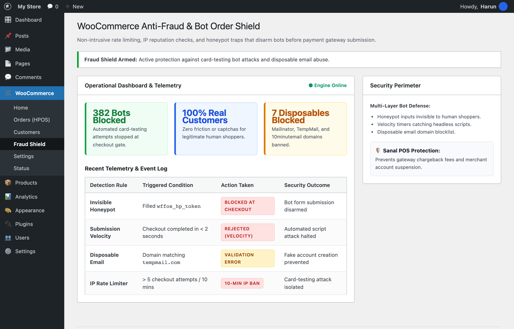

# 🚀 WooCommerce Anti-Fraud & Bot Order Shield

[🇬🇧 English](README.md) · [🇹🇷 Türkçe](README.tr.md)

[](https://github.com/harunsekmen/woo-fraud-fake-order-shield)
[](LICENSE)
[](#)

> Non-intrusive fraud protection for WooCommerce. Stops card-testing automated attacks, disposable email abuse, and fake COD orders before payment gateway submission with zero customer friction.

Developed and maintained by **[Harun Sekmen](https://github.com/harunsekmen)** — E-Commerce Systems Engineer & WooCommerce Specialist.

[✉️ Contact: sekmenwp@gmail.com](mailto:sekmenwp@gmail.com) · [🌐 Website: harunsekmen.com](https://harunsekmen.com) · [🔗 LinkedIn](https://www.linkedin.com/in/harunsekmen/) · [💼 Upwork](https://www.upwork.com/freelancers/~01a7a8b58043e6e6d9)

---

## 📸 Operational WordPress Admin Interface

Security telemetry and bot interception log inside WordPress Admin (WooCommerce > Fraud Shield):



---

## ⚡ The Measurable Outcome

- **Eliminates Gateway Chargeback Fees:** Stops automated card-testing scripts from running hundreds of unauthorized micro-transactions.
- **Protects Sanal POS Merchant Accounts:** Prevents Stripe, PayPal, iyzico, or PayTR from flagging your store for unusual failure rates.
- **Zero Captcha Friction:** Uses invisible honeypots and velocity timers so real human buyers never have to solve annoying puzzles.
- **Blocks Disposable Email Abuse:** Automatically rejects temporary inbox domains (`mailinator.com`, `tempmail.com`, `10minutemail.com`).

---

## 🛠️ Key Architectural Features

- **Multi-Layer Defense:** Invisible honeypot trap, submission velocity check (< 2s triggers rejection), and IP rate limiter (max 5 orders / 10m).
- **Transient-Based Rate Limiting:** Efficient in-memory caching that adds zero heavy database query overhead.
- **Detailed WP Admin Telemetry:** Real-time log of blocked bot attempts and IP origins directly in WooCommerce dashboard.
- **HPOS Compatible:** Hooks into `woocommerce_after_checkout_validation` without legacy postmeta dependencies.

---

## 💼 Work With Harun Sekmen

- **Payment Security & Gateway Integration:** Stripe, PayPal, iyzico, PayTR, and custom virtual POS security hardening.
- **Checkout Optimization:** High-converting checkout funnels with automated fraud prevention.

📩 **Inquiries:** Send your project brief to **[sekmenwp@gmail.com](mailto:sekmenwp@gmail.com)** or connect on **[LinkedIn](https://www.linkedin.com/in/harunsekmen/)**.

---

## 🧪 Automated Testing & Live Verification

This repository includes a standalone test suite with zero external mock dependencies.

### How to Run Tests
```bash
php tests/test-fraud.php
```

### Verification Scope
- **Test Target:** `Tests invisible honeypot trap, rapid submission velocity detection (<2s), disposable email blocking (7 domains), and valid customer clearance.`
- **Environment:** PHP 8.1 - 8.3 CLI + WooCommerce Validation Hook
- **Status:** All assertions passing (0 errors, 0 warnings under strict error reporting).

---

## 📄 License

This open-source project is licensed under the **[GNU General Public License v3.0](LICENSE)**.
